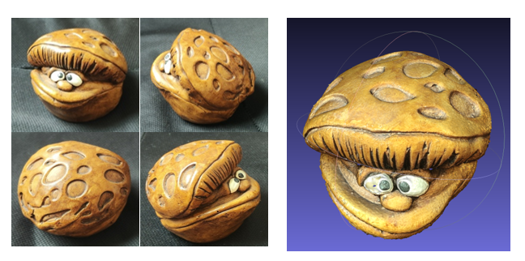

# Multi-View Image to 3D Generation



This repository represents MIRALab’s contribution to the Multi-View 3D generation component of the ENIGMA project, focused on digital reconstruction and damaged Cultural Heritage (CH) objects. In this codebase, the objective is to transform incomplete visual evidence (multi-view images or extracted video frames) into usable 3D assets that support research, restoration analysis, documentation, and immersive visualization workflows.

The service exposes reconstruction through an API-first architecture using FastAPI, Celery, and Redis. It packages a reproducible runtime (Docker + Conda), orchestrates asynchronous 3D reconstruction jobs, and provides standardized outputs for downstream systems. Clients submit image sets or videos, receive a session identifier immediately, and then poll status/download endpoints to retrieve generated models.

The reconstruction backbone in this repository is based on a COLMAP + pycolmap multi-view pipeline. We create a production-oriented service with endpoint design, job queueing, controlled directory/session handling, output conversion to GLB, and deployment-ready containerization.

Within the broader ENIGMA pipeline, this API functions as the 3D generation layer. It can be invoked after preprocessing or curation stages and produces 3D mesh assets (`.ply`, `.glb`) for later refinement, XR visualization, or comparative analysis.

API-first packaging of **multi-view COLMAP reconstruction** for MIRALab workflows.

This repository focuses on making asynchronous multi-image/video-to-3D generation operational as a service (FastAPI + Celery + Redis + Docker), so MIRALab applications can call stable HTTP endpoints and retrieve ready-to-use 3D outputs.

## MIRALab's Goal

- expose 3D reconstruction through API endpoints,
- package runtime dependencies for reproducible execution,
- organize model loading/execution and output handling for service usage,
- support asynchronous processing with session-based status and download.

Main service entrypoint:

- `src/main.py` → FastAPI app with `/multiview_to_3d`, `/video_to_3d`, `/status/{session_id}`, and `/download/{session_id}`

## Repository structure (high level)

- `src/main.py`: API server and async job orchestration
- `src/worker.py`: Celery task worker that runs reconstruction jobs
- `src/colmap.py`: COLMAP/pycolmap reconstruction pipeline (feature extraction, mapping, dense stereo, meshing)
- `src/utils.py`: session directory management, frame extraction, and PLY→GLB conversion
- `src/config.py`: project base path configuration
- `app/input/`: per-session uploaded files and extracted frames
- `app/output/`: per-session reconstruction outputs
- `docker-compose.yml`: multi-service orchestration (FastAPI, Celery worker, Redis)
- `Dockerfile`: CUDA/Conda container build with COLMAP and dependencies

## API contract

### Endpoints

- `POST /multiview_to_3d`
- `POST /video_to_3d`
- `GET /status/{session_id}`
- `GET /download/{session_id}?file_type=glb|ply`

### Input

- `/multiview_to_3d`: `files` (multipart list of images)
- `/video_to_3d`: `file` (multipart video upload)

### Output

- `POST` endpoints return `202 Accepted` with JSON:
  - `message`
  - `session_id`
  - `status_url`
- `/status/{session_id}` returns one of:
  - `not_found`
  - `processing`
  - `error`
  - `ready` (with download URLs)
- `/download/{session_id}` returns:
  - `.glb` (`model/gltf-binary`) or
  - `.ply` (`application/octet-stream`) when available

## Quick start (local)

> Recommended: Linux + NVIDIA GPU + CUDA-compatible environment for dense reconstruction workloads.

1. Create a Python 3.10 environment.
2. Install dependencies:

```bash
pip install -r requirements.txt
```

3. Start Redis (required broker/backend for Celery).

```bash
docker run --name redis_broker -p 6379:6379 -d redis
```

4. Start Celery worker:

```bash
celery -A src.worker.app worker --loglevel=info --concurrency=1 --pool=solo
```

5. Start API:

```bash
uvicorn src.main:app --host 0.0.0.0 --port 8002
```

## Quick start (Docker)

Build and run all services (API + worker + Redis):

```bash
docker compose up --build
```

Services:

- API: `http://localhost:8002`
- Redis: `localhost:6379`

## Example API calls

Create reconstruction from multiple images:

```bash
curl -X POST "http://localhost:8002/multiview_to_3d" \
  -H "accept: application/json" \
  -F "files=@examples/view1.jpg" \
  -F "files=@examples/view2.jpg" \
  -F "files=@examples/view3.jpg"
```

Create reconstruction from video:

```bash
curl -X POST "http://localhost:8002/video_to_3d" \
  -H "accept: application/json" \
  -F "file=@examples/input.mp4"
```

Check processing status:

```bash
curl "http://localhost:8002/status/<session_id>"
```

Download GLB:

```bash
curl -L "http://localhost:8002/download/<session_id>?file_type=glb" \
  --output meshed-poisson.glb
```

Download PLY:

```bash
curl -L "http://localhost:8002/download/<session_id>?file_type=ply" \
  --output meshed-poisson.ply
```

## Notes for GitHub sharing

- Generated artifacts under `app/input/` and `app/output/` should remain out of Git history.
- Reconstruction jobs are asynchronous; consumer applications should always use `session_id` + status polling.
- Keep environment/runtime details (CUDA, COLMAP build, Python deps) explicit for reproducibility.

## Acknowledgement

This project uses upstream reconstruction technologies and libraries including:

- COLMAP: https://github.com/colmap/colmap
- pycolmap (Python bindings for COLMAP)
- Additional geometry/processing libraries used in pipeline utilities (e.g., trimesh, OpenCV, Open3D)

## License and ownership

- This repository includes MIRALab integration/deployment work for ENIGMA workflows.
- Core reconstruction methodology and several algorithmic components originate from upstream projects.
- Review and comply with all upstream licenses and terms for software/model usage and redistribution.

---

Developed by **MIRALab** for API-first 3D model generation workflows.
